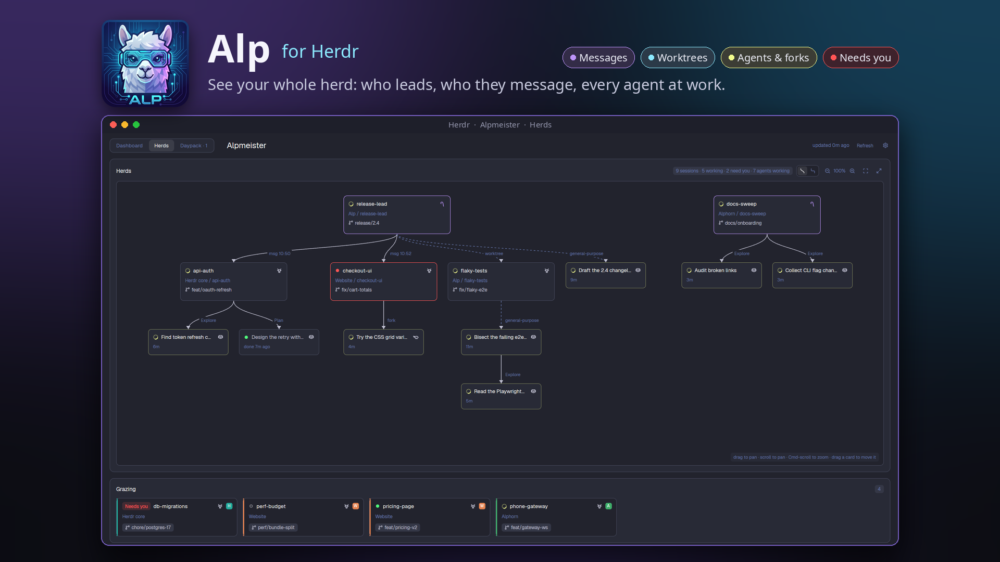

# herdr-alp

A layout for the [Herdr](https://herdr.dev) desktop app, plus the Claude Code plugin that feeds it.

An *Alp* is the high summer pasture of the Swiss Alps: the herd roams the open slopes, unfenced, and the herdsman is up there with it, in charge. This layout is that for coding agents: a sidebar with your account's usage limits, spaces and agents, and a header on every pane with the agent's model, effort, context fill, worktree, branch and status. It comes in [Dracula](https://draculatheme.com) colors.

> [!NOTE]
> **Claude Code only, for now.** The usage limits and the model, effort and context chips come from the `alp` Claude Code plugin. Other agents and shells still get the pane header (name, folder, worktree, status) but no chips. The status files are agent-neutral, so other agents can be added later (see [Status files](#status-files)).



What's inside:

| Path | What it is |
|---|---|
| `layouts/alp.json` | the Herdr layout |
| `themes/alp.json` | its built-in theme: Dracula |
| `mods/usage-limits/` | sidebar block: session (5h) and weekly (7d) usage, with time to reset |
| `mods/pane-agent/` | pane header: icon, name, folder, model/effort/context chips, worktree, branch, status, split/zoom/close |
| `plugins/alp/` | Claude Code plugin that writes the status files the mods read |
| `RECIPE.md` | the brief to rebuild it from scratch (herdr.dev format) |
| `sync.sh` | copy the layout and mods into Herdr's home, or pull live edits back |

## Install

### 1. Herdr layout and mods

```sh
git clone https://github.com/ido-galili/herdr-alp && cd herdr-alp
./sync.sh install                                   # copies layout, theme and mods into ~/.config/herdr-app
herdr-app do layout.switch '{"name":"alp"}'
```

`ctrl-shift-l` switches back to your previous layout. Alp opens in its own Dracula theme (`alp` in the theme picker, offered only on this layout); picking another theme there overrides it.

Or ask your agent to add `herdr.dev/layouts/ido-galili/herdr-alp`: Herdr's `AGENTS.md` tells it how.

### 2. Claude Code plugin

Without it the layout works, but the usage limits show `–` and the pane headers show no chips. This repository is also a Claude Code plugin marketplace, so in a Claude Code session:

```
/plugin marketplace add ido-galili/herdr-alp
/plugin install alp@herdr-alp
```

Pick a scope when asked (user scope loads it in every session). Or from a shell:

```sh
claude plugin marketplace add ido-galili/herdr-alp
claude plugin install alp@herdr-alp
```

Update it later with `/plugin marketplace update herdr-alp`.

**While developing**, load it straight from this folder instead, in `~/.claude/settings.json`:

```json
{ "env": { "CLAUDE_CODE_PLUGIN_DIRS": "~/projects/herdr-alp/plugins/alp" } }
```

Restart running Claude sessions after installing or changing the plugin.

## Status files

The plugin and the mods talk through files in `~/.local/state/herdr-agents/`. They are written per agent, so other agents can report later without changing the mods:

- `<herdr terminal>.json`: `{ "agent": "claude", "model", "effort", "context_pct", "ts" }`. Empty when the agent has exited. The pane header shows the chips only when `agent` matches the program running in the pane.
- `limits.json`: `{ "<agent>": { "five_hour": { "used_percentage", "resets_at" }, "seven_day": {…}, "ts" } }`. Each agent replaces only its own key. `usage-limits` takes `props: { "agent": "…" }` (default `claude`).

To add another agent: make it write these files, then add its program key to `REPORTING` in `mods/pane-agent/main.js`.

## Working on it

Herdr hot-reloads its home, so the quickest loop is to edit there and pull back:

```sh
./sync.sh pull      # ~/.config/herdr-app -> repo
./sync.sh install   # repo -> ~/.config/herdr-app
herdr-app check ~/.config/herdr-app/mods/pane-agent
```

## Planned

- A browser tab.
- A projects tab: issues, pull requests, CI.
- **senn**, the Alp's herdsman: a mod that steers the agents.

## License

[MIT](LICENSE)
