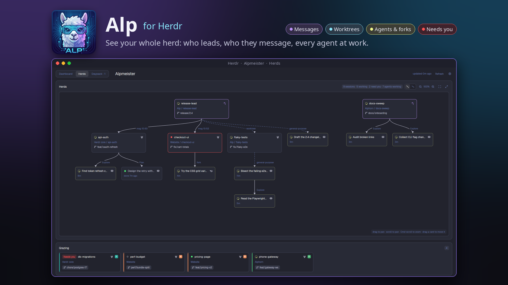

# Alp

A calm, dark Herdr window for running coding agents, where you watch over the herd rather than fence it. A sidebar on the left holds your agent account's usage limits (session and weekly, with how close each reset is), your spaces and your agents. On the right the active tab's panes sit as rounded cards, each with a header showing what runs there: the agent, its folder, its model, reasoning effort and context fill, its worktree and branch, and whether it is working, needs you, or is done.

## What you see

Left to right:

- **Sidebar**, 268px wide (min 44, max 480, not draggable), on the theme's `chrome` background:
  - **Brand row**, 46px: the shipped `workspace-chrome` header (app name, search, sidebar toggle). Drags the window.
  - **Usage limits**, 96px: two rows, `Session` (5-hour window) and `Weekly` (7-day window). Each row: the label (11.5px, `foreground`, medium), the used percentage right after it (semibold, colored by level), and `resets 4h 11m` / `resets 5d 16h` right-aligned in `dim`. Under it an 8px bar with 4px rounding: `border` track, fill in the level color, and a 2×12px `foreground` tick at how far through the window time is (the right end is the reset). Level colors: `accent` below 70%, `working` from 70%, `blocked` from 90%, `dim` with no data (`–`). A 1px `border` line closes the block.
  - **Spaces** and **Agents**: the shipped lists, sharing the rest equally (each at least 90px).
  - **Footer**, 69px: `workspace-chrome` in footer mode (Settings, Add machine).
- **Work area**:
  - **Tabs**, 42px: the shipped tab bar, with the Files / Changes panel buttons. Drags the window.
  - **Body**, 8px padding and gap: the active tab's panes, each a card with `background` fill, 1px `border` outline (1px `accent` when focused), 10px radius, 8px between cards, framed even when alone. To the right a hidden 368px panel (280–900) stacking the shipped `files` and `changes` panels, opened from the tab bar.
  - **Status bar**, 28px: the shipped `workspace-status`.
- Window: `canvas` background, no title bar (traffic lights at 12,16), 1px `border` dividers, terminal padding 14×12.

**Pane header**, 30px, always shown, at the top of each card, 12px text on `background` with a 1px `border` bottom line. Left to right:

1. The program's icon (14px; tinted `dim` when the program table marks it tintable).
2. Its name (`Claude Code`, the shell, or the terminal's title), medium weight, `foreground`, truncated at 260px.
3. The folder, `~`-shortened, in `dim`, taking the free space.
4. Chips (18px high, 5px radius, `hover` fill, 10.5px text), only for an agent that reports status: the model (`claude-opus-5-5` → `Opus 5.5`) in `foreground`; the reasoning effort, capitalized, in `accent`; the context fill as a 44×5px bar plus percentage, colored by the same levels as the limits.
5. A worktree chip in `working` color with a branching icon and the worktree's name, when the folder is a linked git worktree.
6. A branch chip `⎇ main` in `muted`, for reporting agents.
7. Status: a 12px spinner in `working` color while working; a `Needs you` chip (semibold, `blocked` text on `blocked` at 15% opacity) when blocked; a 7px `done` dot when done; nothing when idle.
8. Four 14px icon buttons in `dim` (hover: `hover` fill, `foreground`): split right, split down, zoom/unzoom, close.

## How it behaves

- **working**: spinner turning once every 900ms in the pane header; the shipped agents list and tabs show their own state.
- **blocked**: `Needs you` chip in the header.
- **done**: a small `done`-colored dot.
- **idle**: no status mark.
- Clicking a pane header focuses that pane. The four buttons split it right or down, zoom/unzoom it, or close it; their clicks don't also focus.
- The chips follow the agent live: a `/model` or `/effort` change shows on the next prompt, the context bar after each answer. After `/clear` the context bar disappears until the next answer; when the agent exits, all its chips disappear.
- If something else runs in the terminal later, stale chips stay hidden: they show only when the status file's `agent` matches the program in the pane.
- The limits refresh every 5 seconds and the "resets in" text every 30 seconds. With the sidebar folded under 160px the block becomes a 32px rail cell: a gauge icon, the session percentage, a 24×3px bar and a clock with the time to reset (`4h`, `12m`); the full text is its tooltip.

## Built from

- **Layout** `layouts/alp.json`, cloned from the shipped `main` (0.1.14): `root` row → `sidebar` column (`brand` block, `sidebar-lists` column of `limits` / `spaces` / `agents` blocks, `sidebar-footer` block) and `work` column (`tabs` block, `work-body` row of `main` block + hidden `panel` column with a `panel-body` stack of `files` / `changes`, `status` block). `main` shows `{ "tab": "active" }` with a `pane` frame whose `header` is `{ "content": { "mod": "pane-agent" }, "reveal": "always", "height": 30, "position": "top" }`.
- **Shipped mods used**: `workspace-chrome` (brand, and footer with `props: { footer: true }`), `spaces`, `agents`, `tabs`, `files`, `changes`, `workspace-status`. Art borrowed from them: `mods/workspace-chrome/clock.svg`, `mods/workspace-chrome/spinner.svg`.
- **`mods/usage-limits`**: a `View` reading `~/.local/state/herdr-agents/limits.json` with `readTextFile(home() + …)`, picking the entry for `props.agent` (default `"claude"`). Uses `theme()` and `layout()` (sidebar width for the rail). Art: `gauge.svg`.
- **`mods/pane-agent`**, cloned from the shipped `pane` (0.1.14): `panes()` + `props().pane` for its pane; `readTextFile` of `~/.local/state/herdr-agents/<terminal>.json` every 3 seconds; `exec("git", ["rev-parse", "--path-format=absolute", "--git-dir", "--git-common-dir"])` in the pane's folder (a worktree when the two differ; the worktree name is the git dir's last part); `run("pane.focus" | "pane.split" | "pane.zoom" | "pane.close")`. Art: `close`, `split-down`, `split-right`, `zoom`, `unzoom`, `worktree` SVGs.
- **`plugins/alp`**: a Claude Code plugin (hooks module) that writes the status files; nothing in Claude's own status line. Inside a Herdr terminal (`HC_TERMINAL_ID` set) it writes `<terminal>.json` as `{ agent: "claude", model, effort, context_pct, ts }` on `session.start`, on each main-thread `turn.step` (model, effort) and on `session.measure` (context); on `session.end` it empties the file, or after `/clear` only drops `context_pct`. On `session.measure` with rate limits it rewrites only its own entry in `limits.json`: `{ "claude": { five_hour: { used_percentage, resets_at }, seven_day: {…}, ts } }`.

## Watch out

- Mod art paths are relative to Herdr's home (`mods/pane-agent/zoom.svg`): renaming a mod means renaming its paths too.
- `pane-agent` compares the file's `agent` along with model, effort and context before redrawing; leave `agent` out and a file from another agent keeps showing the old chips.
- `limits.json` is shared by every agent that reports: read it, change your own key, write it back; never overwrite the whole file.
- Context fill is absent right after `/compact` until the next answer; show nothing rather than 0%.
- A Claude Code session keeps the plugin it started with: after installing or changing the plugin, restart running sessions before expecting chips.
- Only Claude Code reports today: the program keys that get chips are the `REPORTING` set at the top of `pane-agent/main.js`.
- The model name shortening only knows `claude-<family>-<major>[-<minor>]`; other ids show as they are.
- Usage limits show `–` until the first answer of any Claude session after the plugin is installed.

## Done when

- `herdr-app check` passes for `mods/usage-limits` and `mods/pane-agent`, and `herdr-app do layout.switch '{"name":"alp"}'` returns ok with no errors in `herdr-app status`.
- A new Claude Code session in a Herdr terminal shows its model, effort and context chips in the pane header within 3 seconds of its first answer, and `~/.local/state/herdr-agents/<terminal>.json` holds `"agent":"claude"`.
- Changing the file's `agent` to anything else hides the chips within 3 seconds.
- The sidebar shows Session and Weekly percentages and reset times matching `limits.json`, and folding the sidebar shows the rail cell.
- Exiting Claude empties the terminal's file and its chips disappear.
